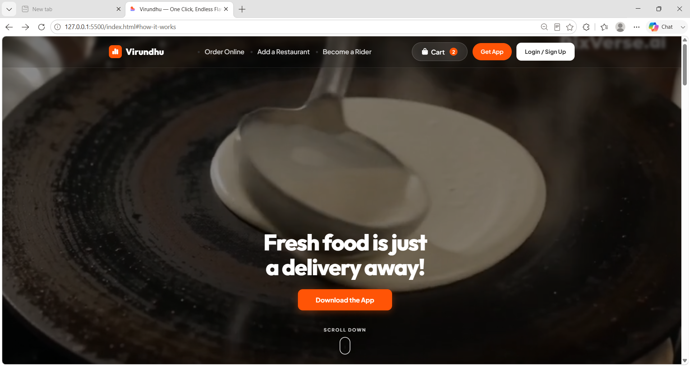
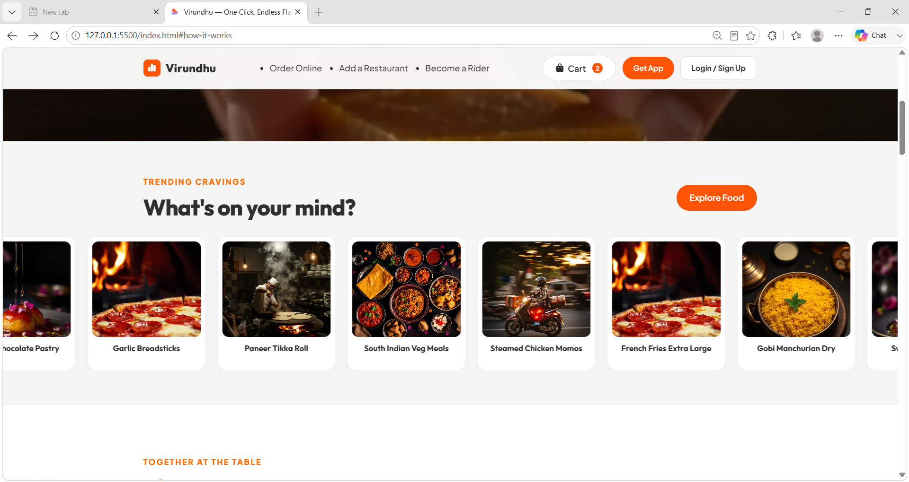
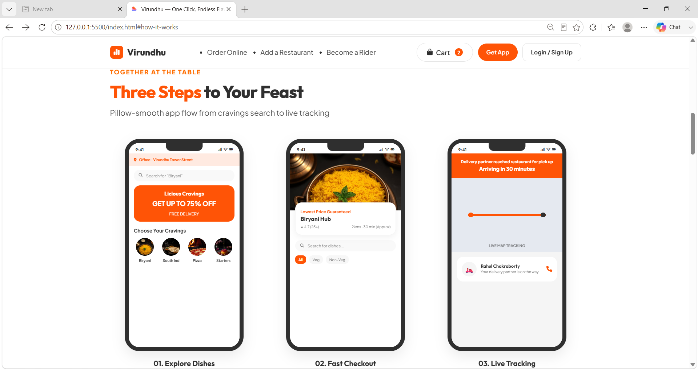
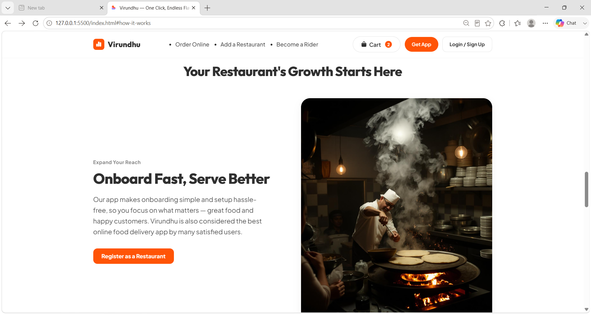
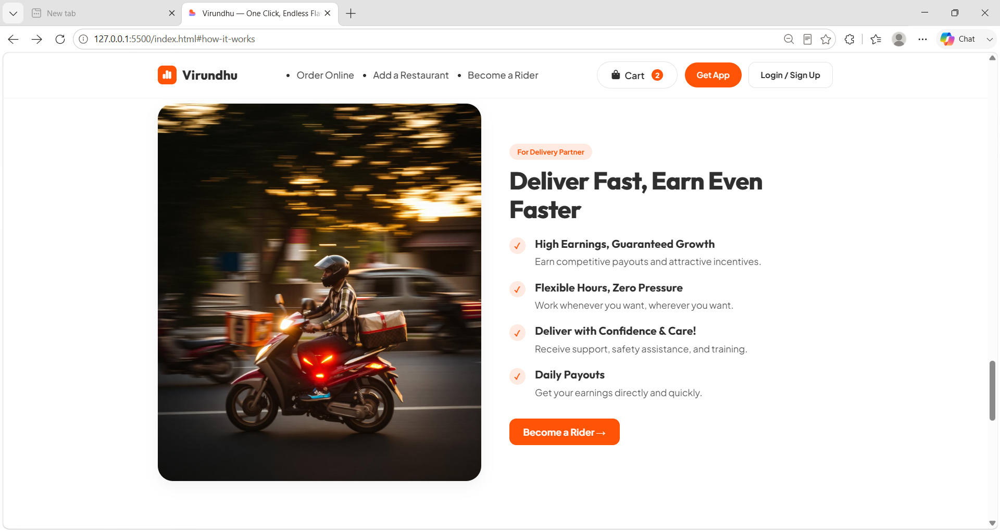
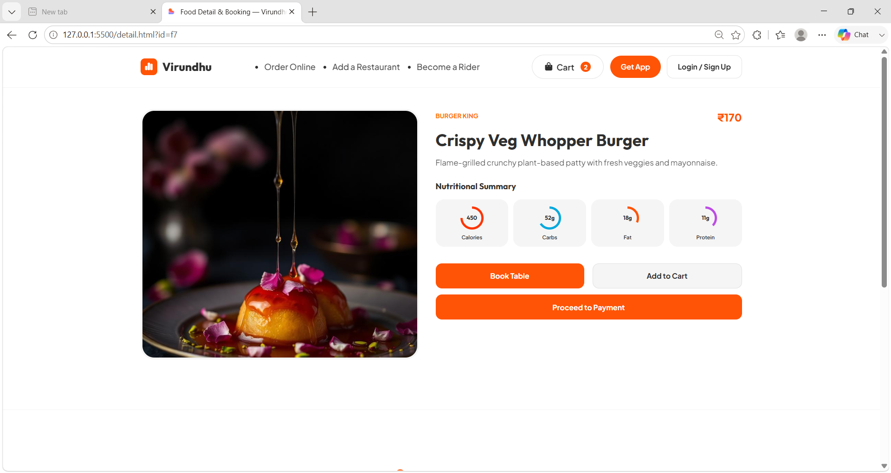
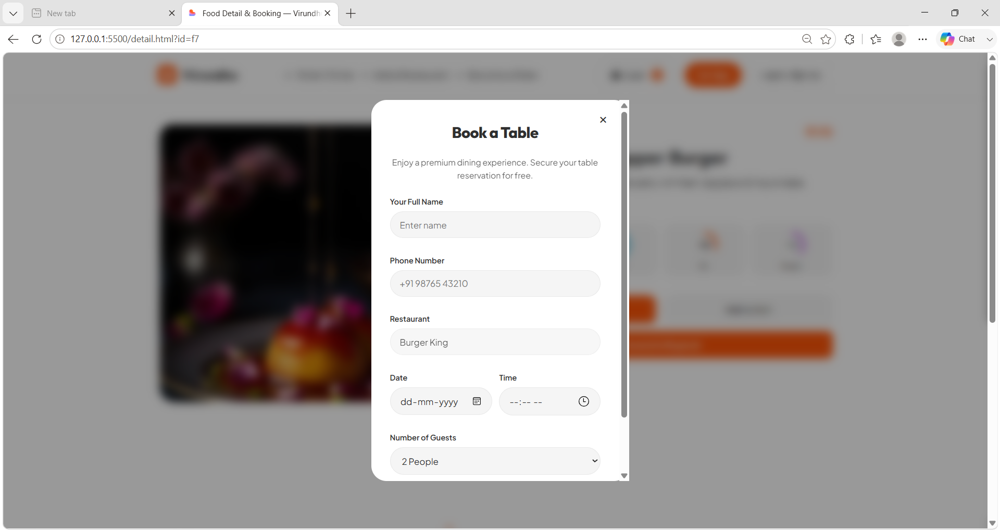
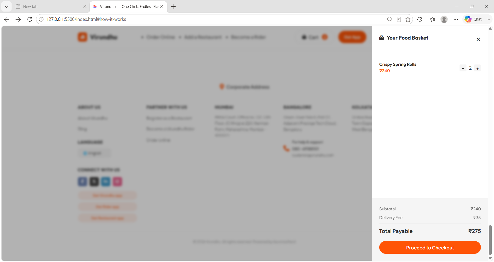
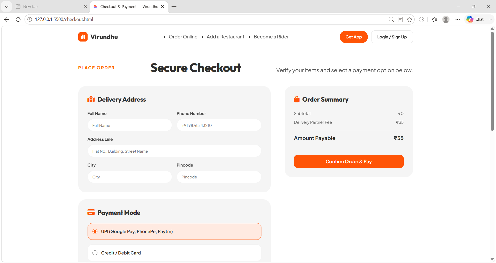
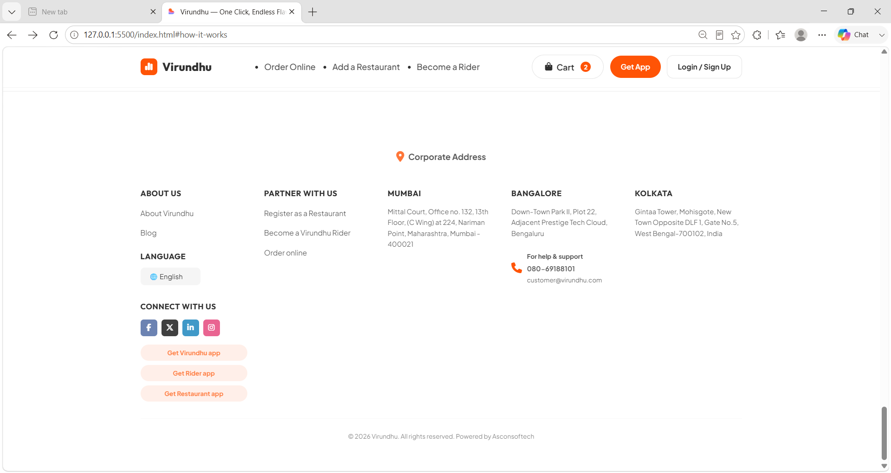

# 🍛 Virundhu — Food Delivery App

> Browse restaurants, explore menus, add items to your cart, sign in with Google, and place your order seamlessly. 🛵

🔗 **Live Demo:** https://github.com/HEMASIVA22/Virundhu • **Code:** https://hemasiva22.github.io/Virundhu/

---

## 🗺 User Journey

🏠 Home → 🍽 Restaurants → 📋 Menu → 🛒 Cart → 🔐 Google Login → ✅ Order Confirmation

---

## 📸 Screenshots

- 🏠 Home Page
  
- 🍽 Items Listing
  
- 📋 Responsive
  

- Add Restaurants
  
- Add Bikers
  
- Foods card
  
- Book a Table
  
- 🛒 Cart Page
  
- ✅ Payment
  
- Footer
  

---

## ✨ Features

- 🎥 Looping Hero Video
- 🍕 Auto-scrolling Food Carousel
- 🍽 Cuisine & Veg/Non-Veg Filters
- 🛒 Add to Cart & Quantity Controls
- 💰 Delivery Fee & Grand Total
- 🔐 Google Authentication (Clerk)
- 🏪 Restaurant Registration
- 🛵 Delivery Rider Registration
- 📱 Fully Responsive Design

---

## 🛠 Tech Stack

- HTML5
- CSS3
- JavaScript (ES6)
- Clerk Authentication
- Google Fonts

## 🤖 AI Assistance

AI tools (Lovable & Anti Gravity) were used for UI ideas, component planning, debugging, and documentation. The project was customized, integrated, and tested by me.

---

## 📚 What I Learned

- Responsive Web Design
- DOM Manipulation
- JavaScript Event Handling
- Cart Management
- Authentication Flow
- Git & GitHub

---

## 🎓 About TAP Academy

Built as part of my Frontend Training at **TAP Academy**, Bangalore.

---

## ⭐ Support

If you like this project, please consider giving it a ⭐ on GitHub.

---

## 👨‍💻 Developed By

**Hema S**
